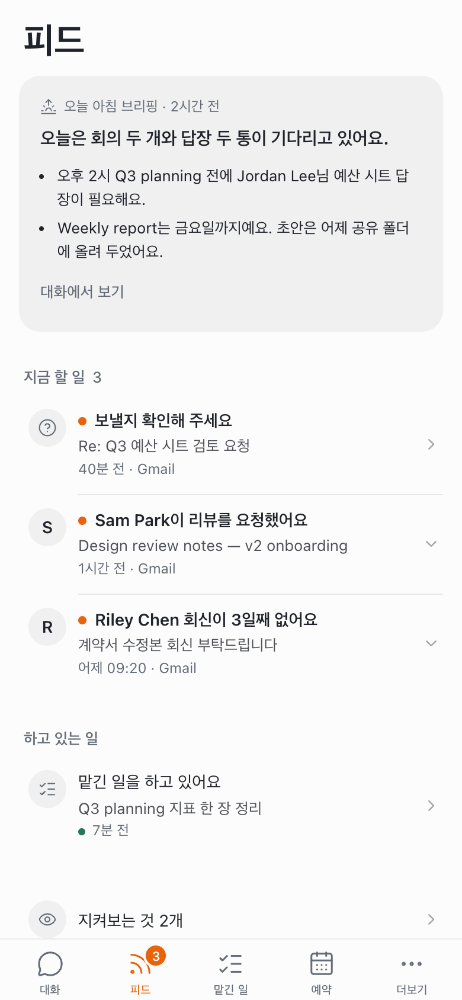
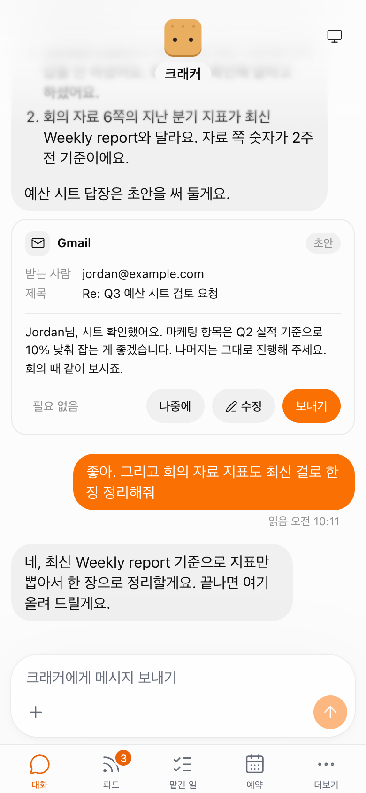
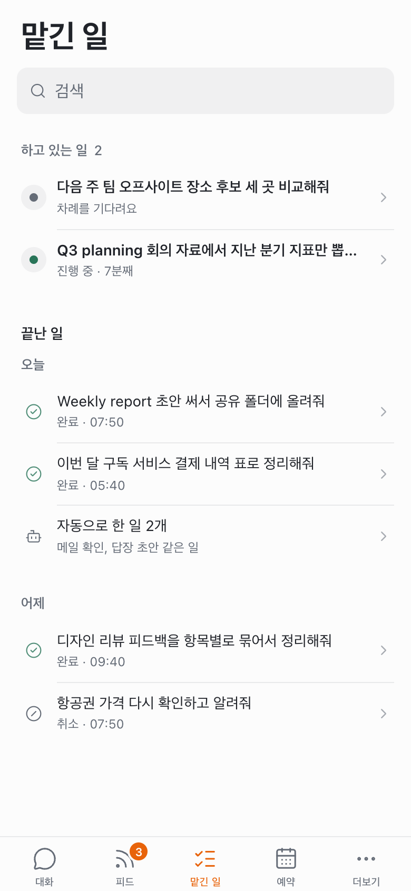
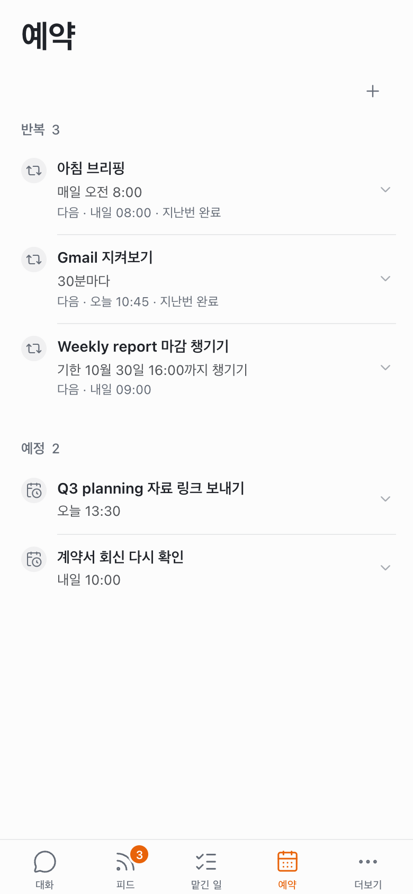
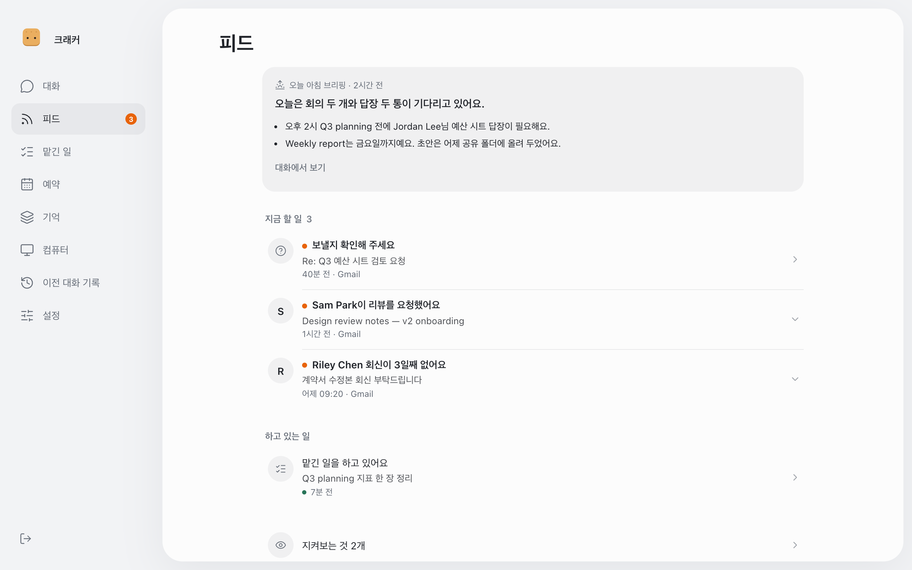
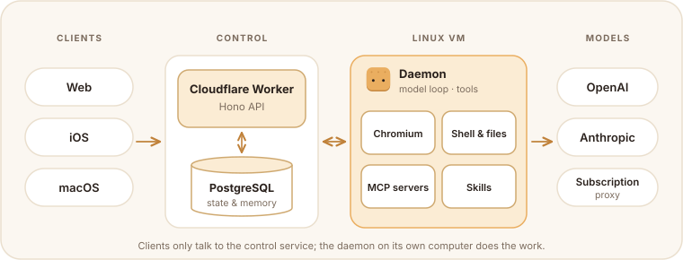

<div align="center">


# 크래커 · Cracker

**A self-hosted assistant you hand things to, and it keeps going until they're done.**

[](LICENSE)
[](tsconfig.json)
[](wrangler.jsonc)
[](infra/migrations)

</div>

Cracker is a personal assistant you run yourself. It keeps an eye on Gmail and Slack, sends you a morning brief, and drafts replies that go out only after you approve them. Routines and reminders run on their own schedule. The work happens on the assistant's own Linux computer, which has a browser, a shell, MCP servers and skills. Cracker remembers things across conversations, and a task stays open until it's finished.

You talk to it from the web, or from the included iOS and macOS apps. The interface is in Korean.

<p align="center">
  
  
  
  
</p>

<p align="center"><sub>Feed · Conversation · Tasks · Schedules. Screenshots use made-up sample data.</sub></p>

## Features

- **One ongoing conversation.** Ask in plain language, attach files and come back later. Earlier conversations stay searchable.
- **Feed.** What needs you comes first, then work in progress, then what has already been done.
- **Watching Gmail and Slack.** Spots requests, deadlines, promises you made and replies you're still waiting on. An item stays open until there's evidence it was handled.
- **Morning brief.** One short summary a day, timed to when your day usually starts.
- **Drafts you approve.** Replies are shown as cards. You can send, edit, postpone or dismiss each one, and nothing goes out unless you approve it.
- **Routines and reminders.** Daily, periodic, deadline-based and one-off work that starts on its own.
- **Its own computer.** A Linux VM with Chromium, a shell and files. You can watch the screen live or take over control.
- **MCP servers and skills.** Connect MCP servers and write versioned skills that the assistant can follow and test.
- **Memory.** Facts are kept with their source, and you can correct or forget them.
- **Durable work.** Tasks and actions are journaled. Interrupted runs recover, temporary provider errors are retried within limits, and actions that may have side effects are not replayed blindly.
- **Your choice of model.** OpenAI or Anthropic APIs, or a ChatGPT subscription through a local proxy. A paid API is never used as a silent fallback.
- **Web, iOS and macOS.** A React web app plus SwiftUI/WebKit shells with native input and push notifications.

<details>
<summary>Desktop layout</summary>
<br>

</details>

## Cracker at work

While Cracker is working, the character in the header shows what it's doing.

<table align="center">
  <tr>
    <td align="center"><br><sub>thinking</sub></td>
    <td align="center"><br><sub>writing a reply</sub></td>
    <td align="center"><br><sub>using the computer</sub></td>
  </tr>
  <tr>
    <td align="center"><br><sub>searching the web</sub></td>
    <td align="center"><br><sub>running code</sub></td>
    <td align="center"><br><sub>recalling</sub></td>
  </tr>
</table>

## Make it yours

Cracker is the default. In settings you can change:

- **Look**: six biscuit shapes (saltine, butter cookie, graham, sandwich, wafer, ring), eight colors, four eye styles, optional blush and an accessory (headphones, beret or bow), with a live preview.
- **Persona**: the assistant's name, its role and the way it talks. On first run you can start from a preset (a thinking partner, a careful researcher or a hands-on doer) or write your own.
- **Instructions**: standing guidance that applies to every conversation.

<p align="center">
  
</p>

## How it works

<p align="center">
  
</p>

Clients talk only to the control service. It keeps conversations, tasks, schedules and memory in PostgreSQL and hands work to the daemon on the Linux VM. The daemon runs the model loop, uses the browser, shell, MCP servers and skills, and reports results back. See [Architecture](docs/ARCHITECTURE.md) for the full picture.

## Memory

Cracker's memory is a tree, because that's how people take notes and think: a topic gets more specific, splits into branches, and links to something else you talked about last week. When you ask something, BM25 and bge-m3 recall candidate topics, Clef picks one and says how sure it is, and a light model steps in only when Clef is unsure. The answering model then reads the original exchanges, not summaries.

<p align="center">
  
</p>

[Read the design → docs/MEMORY.md](docs/MEMORY.md)

## Is it production?

No. And also yes.

I use Cracker every day, and I fix and improve it as I go. Mail watching, the morning brief, routines and the memory tree all run in my own daily work, so most of what you see here is in real use. It is still a personal project, though, not a product: some parts are experimental, and things change quickly.

Treat it as a reference you can read, borrow from and run. Running your own copy will take some work: a PostgreSQL database, a Cloudflare account, an Ubuntu VM for the assistant's computer, your own model provider, and, for the apps, your own Apple and Firebase setup. See [current status and limitations](docs/STATUS.md) and the [setup guide](docs/DEPLOYMENT.md) before you start.

## Quick start

Checked toolchain: Bun 1.2.10, pnpm 10.33.2 and Node.js 24.7.0. Use PostgreSQL 16+. Desktop execution requires a separate Ubuntu 24.04 VM; the control API and web interface can run locally without starting the daemon.

```sh
git clone https://github.com/<you>/autonomous-assistant.git
cd autonomous-assistant
```

```sh
pnpm install --frozen-lockfile
cp .env.example .env
# Edit DATABASE_URL in .env for an empty development database.
bun scripts/migrate.ts
bun scripts/bootstrap.ts
pnpm dev
```

In a second terminal:

```sh
pnpm --dir apps/web dev
```

Open the URL printed by Vite. Bootstrap writes separate client and VM credentials to `.local/connection.json` with restrictive file permissions. Use the client credential to establish a browser session; configure the VM credential only on the daemon. Bootstrap refuses to overwrite an existing connection file.

Configure a provider available to your account. API and ChatGPT authentication paths are explicit; a paid API is not used as an automatic fallback. Provider availability, OAuth access and model identifiers depend on your account.

### Checks

```sh
pnpm check
pnpm exec tsc --noEmit -p tsconfig.worker.json
pnpm --dir apps/web build
```

Database tests must use a **separate disposable database**. See [development and tests](docs/DEVELOPMENT.md) for migration and execution commands. Browser/live probes require their documented fixtures and are not substitutes for physical-device testing.

### Guides

- [Architecture and context lifecycle](docs/ARCHITECTURE.md)
- [Memory as a tree of thought](docs/MEMORY.md)
- [Development and tests](docs/DEVELOPMENT.md)
- [Cloudflare, Linux and Apple setup](docs/DEPLOYMENT.md)
- [Error recovery](docs/ERROR_RECOVERY.md)
- [Parallel runs](docs/PARALLEL_RUNS.md)
- [Apple application build](apps/apple/README.md)
- [Contribution guidelines](CONTRIBUTING.md)

Deployment names and identifiers are examples. Supply your own database, Cloudflare resources, credentials, Apple identifiers and Firebase configuration. Private conversation exports, operational evidence, credentials and app binaries are excluded.

## Project layout

| Directory | Responsibility |
| --- | --- |
| `apps/web` | React conversation, computer viewer and settings |
| `apps/apple` | SwiftUI/WebKit shells, native input and notification integration |
| `services/control` | Hono API, sessions, durable work state and screen signaling |
| `services/daemon` | Linux execution, provider connections and durable action journal |
| `packages/context` | Source-backed semantic contexts, bounded retrieval and revisioned reorganization |
| `packages` | Tools, MCP/skills, artifacts, memory, notifications and provider adapters |
| `infra` | PostgreSQL migrations, Cloudflare configuration and Linux services |
| `tests` | Unit, database, protocol and opt-in browser/live scenarios |

## Acknowledgements

Cracker builds on the work of these projects. Thank you to their authors.

- [CLIProxyAPI](https://github.com/router-for-me/CLIProxyAPI) by Luis Pater (MIT): the subscription model proxy. The VM installer downloads its official release binary.
- [open-computer-use](https://github.com/iFurySt/open-codex-computer-use) by Leo (MIT): the desktop control MCP server.
- [Playwright MCP](https://github.com/microsoft/playwright-mcp) (Apache-2.0): browser tools.

Details and other dependency licenses are in [THIRD_PARTY_NOTICES.md](THIRD_PARTY_NOTICES.md).

## License

[MIT](LICENSE). Dependencies keep their own licenses; see [third-party components](THIRD_PARTY_NOTICES.md).
