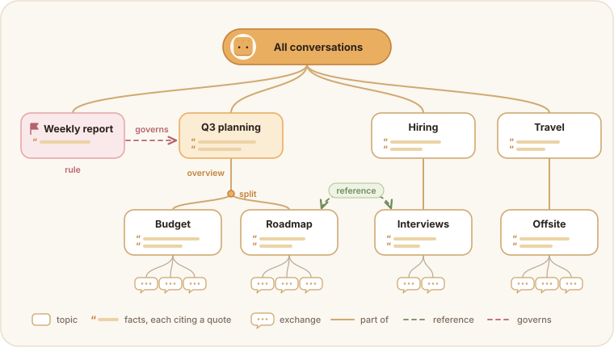
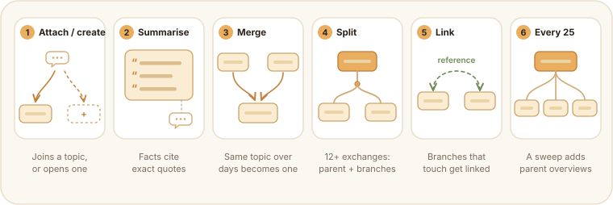
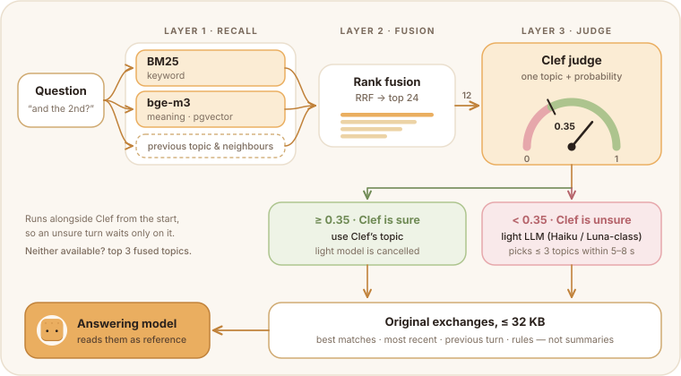

# Memory as a tree of thought

*How Cracker turns months of conversation into a knowledge tree, and how it finds the right branch in under a second.*

## 1. Why one conversation needs real memory

Cracker has a single, endless conversation. There are no separate chats for "work", "travel" or "that contract". If memory and knowledge are managed well, the work sorts itself; if they are not, one conversation becomes a pile.

So the question we cared about most was not which model answers, but **what the model is shown**. A personal assistant falls short almost everywhere on the same thing: it forgets, or it remembers the wrong thing at the wrong time.

## 2. Why a tree

We chose a tree because it is closest to how people take notes and think. A thought starts as one topic, gets more specific, splits into two, and the new branch turns out to touch something else you were thinking about last week. Notes and mind-maps grow tail-to-head in the same way.

Cracker's memory grows like that:

- Each exchange (a message and its reply) belongs to one **topic node**.
- When a topic gets specific enough, the model **splits** it into sub-topics. The original becomes their parent and keeps an overview.
- Topics that turn out to be the same thing, spread over several days, are **merged**.
- When a branch touches another branch, the two are **linked** (`reference`), and standing instructions are linked to what they **govern**.
- Periodically, close topics get a **parent** that summarises them, so a broad question can land on the overview.

The model decides the structure; the code decides whether a decision is allowed.

### 2.1 What a node is

| Field | Meaning |
| --- | --- |
| `kind` | `topic` (something talked about), `rule` (a standing instruction), `event` (a dated occurrence) |
| `title`, `aliases`, `entities` | The words the user actually uses for it, other spellings, and the people/things it is about |
| `summary` | Up to 24 facts, **each citing an exact quote** from an exchange |
| `owners` / `mentions` | The exchanges it holds; every exchange has exactly one owner |
| links | `part_of`, `reference`, `governs` |

### 2.2 How it grows

After each answer, the exchange is queued and grown in the background, only while no one is waiting for a reply.

1. **Noise.** Greetings and one-word acknowledgements attach to the previous topic without a model call.
2. **Candidates.** A top-down descent from the root by embedding similarity, with a threshold that tightens with depth, $\theta(d) = 0.45\,e^{d/30}$; plus BM25 over node text; plus the previous exchange's topic.
3. **Attach or create.** The model places the exchange under an existing topic or opens a new one.
4. **Summarise.** The topic's facts are patched; up to three ancestors' overviews are rewritten.
5. **Merge, split, link.** Merge candidates (embedding similarity and shared entities) are confirmed by the model; a topic that owns 12 or more exchanges is clustered and, if the model agrees, split; shared entities propose links.
6. **Every 25 exchanges**, a sweep merges strays and builds parent overviews.

Every step is an operation (`create_node`, `merge`, `split`, `add_link`, …) that the server applies atomically only if the tree's invariants hold and every cited quote appears verbatim in an exchange the user allowed to be remembered. A step that fails is skipped, never half-applied. Forgetting an exchange removes it from every node and drops facts left without evidence.

## 3. Finding the right branch

Retrieval has to be fast, because it runs before every answer. It is layered: cheap, broad signals first, a fast judge next, and a slower model only when the judge is unsure.

1. **Recall: keyword and meaning.** BM25 over node titles, aliases and summaries, and **bge-m3** embeddings searched in PostgreSQL (pgvector), run in parallel. The previous topic's neighbourhood (itself, parent, children, links) is added so a short follow-up like "and the second one?" stays on topic.
2. **Fusion.** Reciprocal rank fusion, $\text{score}(n)=\sum_l 1/(61+\text{rank}_l(n))$, keeps the top 24. No weights to tune.
3. **Judge: Clef.** A small decision model sees the question, the last two exchanges and compact cards for the top 12 topics, and picks one, or *uncertain*, **with a probability**.
4. **Fallback: a light LLM.** It starts at the same time as Clef. If Clef's confidence is at least 0.35, Clef's pick wins and the light model is cancelled. Otherwise the light model (a small Claude or GPT model, matching the workspace's provider) picks up to three topics, or none, within a few seconds (5 s for the Claude model, 8 s for the GPT model). If both are unavailable, the top three fused candidates are used.
5. **Delivery.** The answering model receives the **original exchanges** of the chosen topics, not summaries: the best matches inside each topic, the most recent ones, the previous exchange, and rules in their own slot, cut to fit 32 KB.

### 3.1 Why Clef as the judge

Choosing a topic is a small judgement, not a ranking and not an essay.

- **It knows more than a ranker.** A reranker scores similarity; Clef brings enough world knowledge to tell that "the card thing" and "issuing structure" are the same topic.
- **It is faster than an LLM.** It answers in a fraction of the time a general model needs, so most turns never wait for one.
- **It returns a probability.** That number is what makes the layering possible: trust it when it is sure, ask a light model when it is not.

We also tried a sibling model of Clef; its Korean understanding was noticeably weaker, and Clef led on benchmarks, so Clef stayed.

## 4. Measuring it on real history

The structure and the retrieval were tuned offline by replaying our own conversation history in order: grow the tree exchange by exchange, ask each question against the tree as it was at that moment, and score whether the right topics came back. That replay is how we picked the embedding model, the fusion, the Clef prompt and the confidence threshold. The data and the evaluation set stay private.

So far, knowledge is structured and kept better than we expected. The real test is scale: what the tree looks like after a year of conversation is still an open question.

## 5. Memory around the tree

The tree is one of three things the answering model sees, plus tools to dig deeper.

| Layer | What | Selection |
| --- | --- | --- |
| Explicit memories | Facts the user asked to keep, with corrections and validity windows | All current ones in scope; a correction supersedes the original |
| Recent work | The last 8 tasks in this conversation, as short excerpts | Recency |
| Knowledge tree | Every past exchange in the workspace, by topic | §3 |
| Archive | Every message, file and indexed document | On demand, through search tools |

## Code map

| Concern | Files |
| --- | --- |
| Tree rules: descent, fusion, Clef choice, invariants | `packages/knowledge-tree/core.ts`, `schema.ts` |
| Evidence ordering and budget | `packages/knowledge-tree/deliver.ts` |
| Storage, validated apply, forget | `packages/knowledge-tree/store.ts`, `forget.ts`, `infra/migrations/064_knowledge_tree.sql` |
| Background growth | `services/daemon/knowledge-tree-growth.ts`, `knowledge-tree.ts` |
| Question-time retrieval | `services/daemon/knowledge-tree-retrieval.ts`, `auxiliary-model.ts` |
| Explicit memories | `packages/memory/` |

The tree is enabled with `KNOWLEDGE_TREE_MODE=on` (`shadow` grows it without using it, to build it from existing conversations first).
